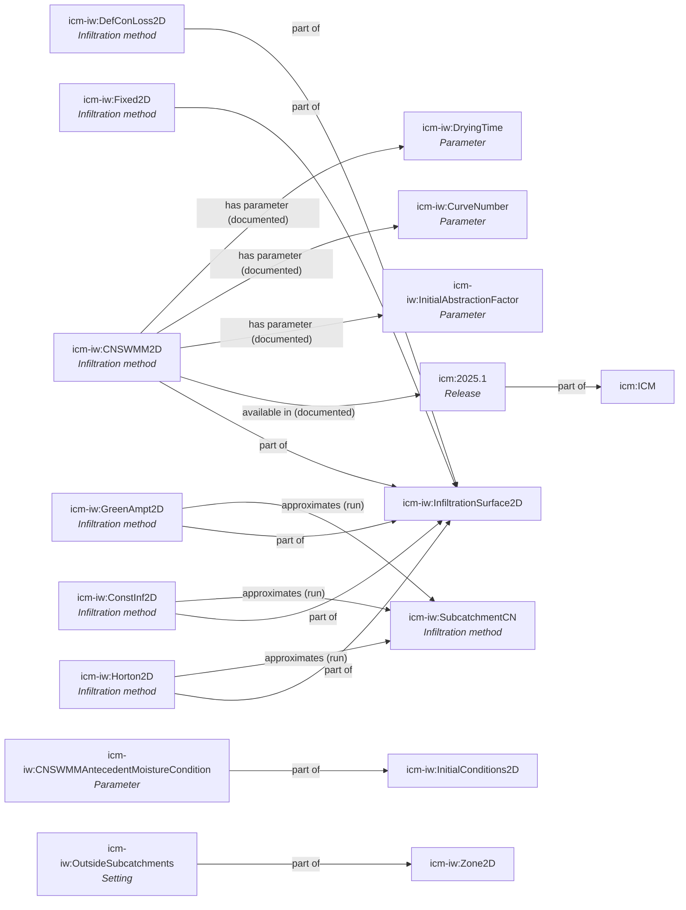
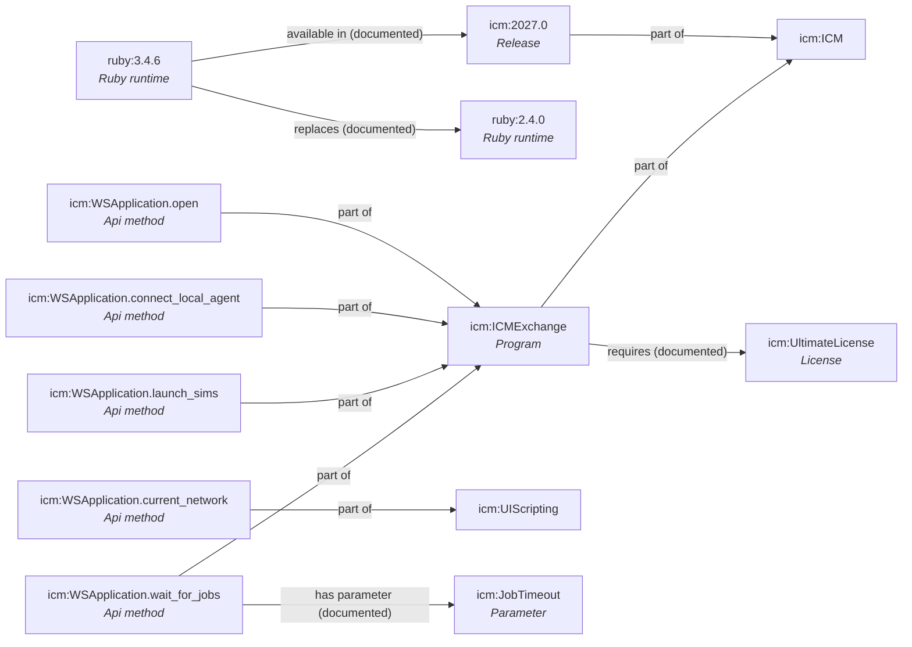
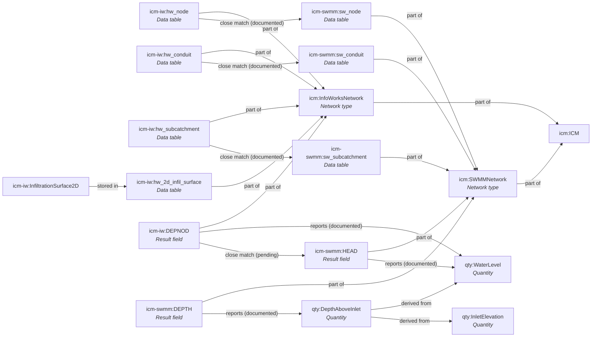

# Ontology graph (built)

Built by `tools/ontology.py` from the Relations tables; do not edit by hand. Classes from `is_a` are shown in italics inside each box; a relation with a `verification` qualifier shows it in parentheses (run, pending or documented). See [ONTOLOGY.md](../ONTOLOGY.md).

## wiki/concepts/icm-2d-rainfall-and-infiltration.md

## wiki/concepts/icm-ruby-ui-and-exchange.md

## wiki/concepts/icm-tables-and-result-fields.md

